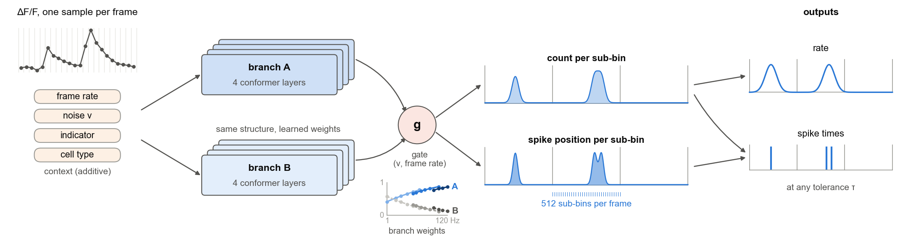

# SETSUNA

**Spike Estimation with Temporal Super-resolution, Universal across Neuron types and Acquisition settings.**

SETSUNA infers spikes from two-photon calcium imaging on a time grid 512 times finer than the imaging frame. One network
design, conditioned on frame rate, noise level, indicator and cell type, serves frame rates from 1 to 120 Hz and the noise
levels of real experiments, and generalizes across indicators and cell types, including those for which no simultaneous
electrophysiology was available in training.



The trace is conditioned additively on frame rate, noise level, indicator and cell type and processed by two conformer
branches mixed by a gate; a count head and a within-frame head return 512 sub-bins per frame, from which the rate and
spike times at the analysis's timing tolerance are decoded.

```python
import setsuna
dff = setsuna.dff_from_fluorescence(F, Fneu, fps=30.0)          # raw + neuropil fluorescence -> fractional dF/F
out = setsuna.infer(dff, fps=30.0, indicator="jGCaMP8s", tolerance_ms=10)
out["rate"]          # expected spikes per frame
# for rate analyses, smoothing is recommended: infer(..., smooth_ms=25) adds out["rate_smooth"], the sub-frame
# rate smoothed with a 25-ms Gaussian (spikes/s)
out["spike_times"]   # spike times (s), decoded at 10-ms precision
```

```
setsuna run --npz traces.npz --fps 30 --indicator jGCaMP8s --tolerance-ms 10 --out spikes.npz
```

## Install

    pip install git+https://github.com/ryhattori/setsuna.git

Requires Python >= 3.10 and PyTorch >= 2.2; install PyTorch with CUDA first for GPU inference (see the user guide).
The trained models (release v0.9.0, about 64 MB) are downloaded the first time you run SETSUNA; to install them
beforehand, run

    setsuna download-models

## Documentation

[docs/USER_GUIDE.md](docs/USER_GUIDE.md): installing, a demo notebook on a recording with electrophysiology (`examples/demo.ipynb`),
preparing input, choosing the indicator, cell type and timing tolerance, rates-only and sub-frame outputs, and
reading the output.

SETSUNA is also built into JupiterScope, which runs it from a GUI after registration, segmentation and fluorescence
extraction.

## Citation

Hattori, R. Breaking the frame-rate limit of calcium imaging (2026).

## Licence

Copyright (C) 2026 Ryoma Hattori.

SETSUNA, including its trained models, is free software: you can redistribute it and/or modify it under the terms of the GNU General
Public License as published by the Free Software Foundation, either version 3 of the License, or (at your option) any
later version. It is distributed in the hope that it will be useful, but WITHOUT ANY WARRANTY; without even the implied
warranty of MERCHANTABILITY or FITNESS FOR A PARTICULAR PURPOSE. See [LICENSE](LICENSE) for the full text.
